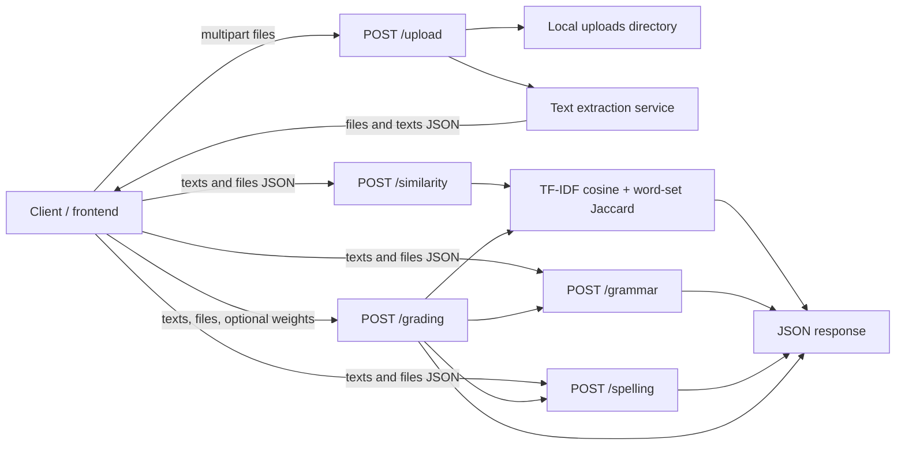

# CopyCatch

CopyCatch is a document and text similarity detection system intended to help educators compare student assignments. It extracts text from uploaded documents and compares documents submitted together. Its results indicate textual similarity; they do not determine plagiarism, intent, or unauthorized collaboration.

## Features

### Core similarity detection

- Accepts PDF, DOCX, and TXT files through the upload endpoint.
- Extracts document text and returns it with the submitted filenames.
- Compares documents submitted in the same similarity request using TF-IDF cosine similarity and word-set Jaccard similarity.
- Combines those measures into a batch-relative score and assigns a threshold-based status.

### Additional features

- Grammar checking through LanguageTool configured for `en-US`.
- Spelling checking through `pyspellchecker`.
- A grading endpoint combines grammar, spelling, and originality scores using supplied or default weights. This is separate from the core similarity result.

## Technology Stack

- Python 3.10 (the version used by the Docker base image)
- FastAPI and Uvicorn
- scikit-learn (TF-IDF vectorization and cosine similarity)
- pdfplumber (PDF text extraction)
- python-docx (DOCX text extraction)
- LanguageTool via `language_tool_python` (grammar checking; Java is installed in the Docker image)
- pyspellchecker (spelling checking)

The complete pinned Python dependency list is in `requirements.txt`.

## System Architecture

The backend is a FastAPI application. `main.py` registers route modules, configures CORS, and exposes a root health-style response. Routes call service functions for extraction, similarity, grading, grammar, and spelling. The upload route writes files to a local `uploads` directory and returns extracted text. Later analysis endpoints accept text and filenames in JSON; they do not retrieve text from the saved files.



## System/Data Flow

The verified flow is:

**Client → file upload → local file write → text extraction → upload response containing text → client submits text and filenames to analysis endpoint → JSON result.**

For similarity, preprocessing is applied within the similarity service before TF-IDF vectorization and Jaccard comparison. The grading endpoint invokes similarity, grammar, and spelling services, then combines their scores. There is no report-generation or file-download endpoint in the backend source.

## Similarity Detection Methodology

- **Text preprocessing:** `services.preprocess.clean_text` lowercases text, removes punctuation other than word characters and whitespace, collapses whitespace, and trims the result. It is applied to all supplied texts in a similarity calculation.
- **TF-IDF:** `TfidfVectorizer(ngram_range=(1, 2))` builds TF-IDF features over unigrams and bigrams for the documents in the current request. The vectorizer is fitted to that request’s document set.
- **Cosine similarity:** scikit-learn computes pairwise cosine similarity between the TF-IDF vectors.
- **N-gram analysis:** Unigrams and bigrams are included as TF-IDF features for cosine similarity. The implementation does not calculate or return a separate n-gram score.
- **Jaccard similarity:** The service splits cleaned text on whitespace, converts each document’s tokens to a set, and divides the intersection size by the union size. It is word-set Jaccard; repeated token frequency does not affect the result. When both sets are empty, the function returns 0.
- **Combined score:** For each document, the service selects its highest score against another submitted document: `0.7 × cosine + 0.3 × Jaccard`. It reports that value as a percentage rounded to two decimal places. Status thresholds are `High Risk` at 70% or above, `Moderate` at 40% or above, and `Safe` below 40%.

These scores compare only documents supplied in the same request. They are similarity indicators, not definitive plagiarism findings.

## Installation

From the repository root, create and activate a Python 3.10 virtual environment, then install the pinned dependencies:

```powershell
py -3.10 -m venv venv
.\venv\Scripts\Activate.ps1
python -m pip install -r requirements.txt
```

On a POSIX shell, the activation command is `source venv/bin/activate`. Grammar checking uses `language_tool_python`; Java is installed in the Docker image. Local Java and LanguageTool runtime requirements should be confirmed for the target environment.

## Configuration

No required environment variables are read by the reviewed backend source. CORS origins are defined directly in `main.py`; the upload directory and Docker port are also fixed in source/configuration. No `.env.example` is present.

## Running the Backend

From the repository root with the virtual environment active:

```powershell
uvicorn main:app --reload --host 127.0.0.1 --port 8000
```

The Docker image instead starts Uvicorn on `0.0.0.0:8080` (see Deployment). Interactive API documentation is provided by FastAPI’s standard application behavior at `/docs` when enabled by the framework defaults.

## API Overview

All analysis endpoints use JSON except for the multipart upload endpoint. Analysis responses are JSON objects containing a `results` array, except upload, which returns a message plus `files` and `texts` arrays.

| Method | Endpoint | Purpose | Request and response |
|---|---|---|---|
| GET | `/` | Root status response | Returns `{"message":"Backend Running...."}`. |
| POST | `/upload` | Upload and extract documents | Multipart form field `files` accepts multiple files. Filename extensions allowed by the route are `.pdf`, `.docx`, and `.txt`. Returns `message`, `files`, and extracted `texts` arrays. Unsupported extensions raise HTTP 400. |
| POST | `/similarity` | Compare submitted documents | JSON keys `texts` and `files` are accessed directly. Returns `results`; each item includes `file`, `status`, `most_similar`, and `similarity`. |
| POST | `/grading` | Combine grammar, spelling, and originality scores | JSON may contain `texts`, `files`, and `weights`. Default weights are grammar 40, spelling 30, originality 30. Returns per-file totals and component/final scores. |
| POST | `/grammar` | Check grammar | JSON keys `texts` and `files` are read with empty-list defaults. Returns grammar results including issue details and original text. |
| POST | `/spelling` | Check spelling | JSON keys `texts` and `files` are accessed directly. Returns spelling results including misspelled words and original text. |

The source does not define explicit request/response schemas for these endpoints. `texts` and `files` are expected to be corresponding arrays, but the routes do not consistently validate their types or lengths.

## User Roles

No user roles, accounts, authentication, or permissions are implemented in the reviewed backend source. The source therefore does not establish role-specific access. Network or hosting access controls, if any, are outside this repository’s verified implementation.

## Project Structure

```text
main.py                  FastAPI app, CORS configuration, route registration
routes/                  HTTP route handlers
services/                Extraction, preprocessing, similarity, scoring, and checks
uploads/                 Runtime local upload directory created by the upload route
requirements.txt         Pinned Python dependencies
Dockerfile               Container build and Uvicorn startup configuration
docs/                    Technical architecture and code review documentation
```

## Deployment

The repository’s Dockerfile uses `python:3.10`, installs `openjdk-21-jdk`, installs `requirements.txt`, copies the project, and runs `uvicorn main:app --host 0.0.0.0 --port 8080`. Uploaded files are stored in the container’s relative `uploads` directory. Persistent storage, retention, and cleanup are not configured in the reviewed source and would need deployment-level planning.

## Security Considerations

- CORS is configured with three explicit origins in `main.py`: two hosted frontend origins and `http://localhost:5173`. Credentials, methods, and headers are allowed by the CORS middleware configuration.
- The upload route allows only three filename extensions, but the reviewed code does not verify file signatures, enforce upload size limits, or replace client-provided filenames before constructing storage paths.
- No authentication, authorization, rate limiting, or role checks are visible in the backend source.
- Uploads are retained in local storage, and the upload route prints the first 200 extracted characters. Grammar and spelling responses also include original text.

These are descriptions of the inspected code, not a compliance assessment. This repository does not establish compliance with RA 10173 or any other privacy/security standard.

## Limitations

- Similarity is limited to documents in the same request batch; there is no document database or persistent comparison corpus in the reviewed backend.
- N-grams are TF-IDF features for cosine comparison, not an independent reported algorithm.
- Scanned PDF OCR is not implemented. DOCX extraction reads paragraphs but does not traverse tables.
- Empty documents, mismatched text/filename arrays, malformed files, and large requests do not have comprehensive validation or normalized error handling.
- A one-document similarity request has no other candidate; current code returns the same filename as `most_similar` with a zero score.
- There is no generated report or report-download endpoint.
- Grammar and spelling checks use heuristic scores and are additional features, not the core similarity method.

## Future Improvements

Potential improvements, not current capabilities:

- Add typed request models, consistent validation, and controlled error responses.
- Use generated safe storage names, upload size limits, content validation, retention policies, and avoid logging document content.
- Define empty/single-document behavior and test similarity scoring boundaries and extraction edge cases.
- Add OCR if scanned documents must be supported, and include DOCX tables if needed.
- Consider background processing and bounded workloads for large batches.
- Add an explicit report format/download flow if required by the product or thesis presentation.
- Move CORS, thresholds, and other deployment settings into documented configuration where appropriate.
