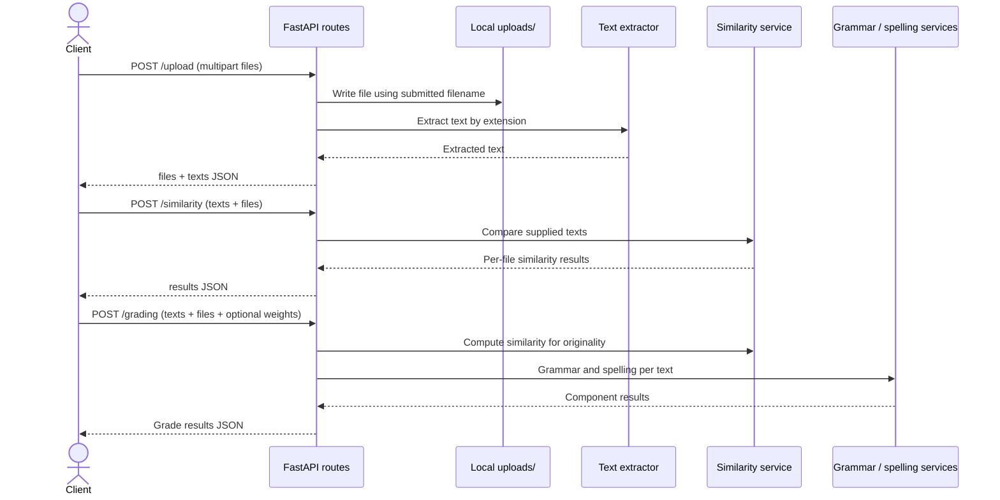

# CopyCatch Backend Architecture

## System Overview

CopyCatch’s inspected backend is a FastAPI application that accepts document uploads, extracts text, and provides separate endpoints for similarity, grading, grammar, and spelling analysis. Analysis endpoints receive text and filenames from the caller as JSON. The backend does not persist an analysis session or retrieve the uploaded file’s text for later requests.

## Frontend/Backend Relationship

The backend permits browser requests from two configured hosted origins and `http://localhost:5173`. The source does not include the frontend, so its implementation and exact call sequence are not verifiable here. The upload response contains `files` and `texts`, which callers can submit to the analysis routes.

## Backend Components

- **`main.py`:** Creates the FastAPI app, configures CORS, defines `GET /`, and registers route modules.
- **`routes/upload.py`:** Accepts multiple files, checks filename extensions, saves files under relative `uploads/`, calls the extraction service, and returns filenames and text.
- **`routes/similarity.py`:** Passes submitted `texts` and `files` to the similarity service.
- **`routes/grading.py`:** Passes submitted data and optional weights to the grading service.
- **`routes/grammar.py` and `routes/spelling.py`:** Call the grammar and spelling services for each submitted text.
- **`services/text_extractor.py`:** Extracts TXT, DOCX, or PDF text.
- **`services/preprocess.py`:** Normalizes text for similarity analysis.
- **`services/similarity.py`:** Computes TF-IDF cosine and word-set Jaccard, combines scores, selects the top match, and assigns a status.
- **`services/grading.py`:** Combines grammar, spelling, and derived originality scores.
- **`services/grammar.py`:** Calls LanguageTool configured for `en-US`.
- **`services/spelling.py`:** Uses `pyspellchecker` to find unknown words.

## Data Flow

`POST /grammar` and `POST /spelling` independently call their check service and return JSON results. No report-file generation or download step is implemented in the reviewed backend.

## Similarity Detection Pipeline

1. Each submitted text passes through `services.preprocess.clean_text`: lowercase, remove punctuation outside word characters/whitespace, collapse whitespace, and trim.
2. `TfidfVectorizer(ngram_range=(1, 2))` fits TF-IDF features using the documents in that request. The features include unigrams and bigrams.
3. scikit-learn calculates pairwise cosine similarity over the TF-IDF vectors.
4. A separate word-set Jaccard score is calculated from whitespace-separated cleaned tokens.
5. Candidate scores are combined as 70% cosine plus 30% Jaccard. Each document is assigned its maximum score against another input document. The percentage and threshold status are returned.

There is no separately computed n-gram score. Results are relative to the documents included in that request.

## External Services and Dependencies

- `language_tool_python` provides grammar checking and is configured with `en-US`. The Dockerfile installs OpenJDK 21. The actual runtime startup behavior should be verified in the target environment.
- `pyspellchecker` provides spelling checks.
- `pdfplumber` and `python-docx` parse PDF and DOCX files.
- scikit-learn performs TF-IDF vectorization and cosine similarity.
- The source does not show a database, external API integration for similarity, OCR engine, task queue, or object storage.

## Architecture Boundaries and Limitations

- Uploaded documents are saved locally, but later analysis requests consume client-submitted text rather than a server-side upload identifier.
- The upload route checks extension but has no visible size cap, safe server-generated path, or cleanup policy.
- PDF extraction is text-based; OCR is not present. DOCX extraction iterates paragraphs and does not inspect tables.
- The analysis routes do not have a shared explicit request schema in the inspected source.
- The backend returns JSON analysis results; no report file is generated by a registered route.
